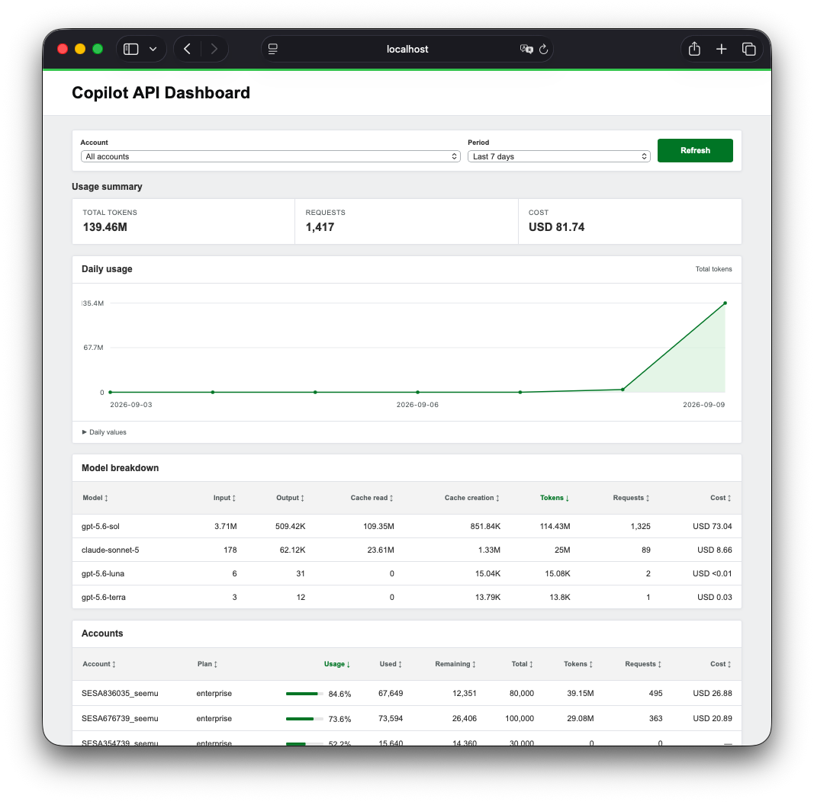

# Copilot API Dashboard

A read-only usage dashboard for multiple [Copilot API](https://github.com/caozhiyuan/copilot-api) instances and accounts. View quotas, tokens, requests, costs, and cache hit rate, with daily trends, model breakdowns, and per-account request events. Account and period views can be bookmarked.

[Docker](#docker) · [Binary](#binary) · [Configuration](#configuration) · [Development](#development)

> [!WARNING]
> The dashboard has no authentication. Docker discovery requires access to the Docker socket. Expose the dashboard only on a trusted network or behind an authenticating proxy.

<p align="center">
  <a href="docs/images/dashboard-overview.png"></a>
</p>

## Docker

For automatic discovery, the dashboard and Copilot API containers must share a Docker network. The examples use `service`; create it if needed:

```sh
docker network create service
```

Run the published image (`linux/amd64`):

```sh
docker run -d --name copilot-api-dashboard \
  --network service \
  -p 127.0.0.1:9000:9000 \
  -e TZ=Asia/Shanghai \
  -v /var/run/docker.sock:/var/run/docker.sock:ro \
  ghcr.io/nervebing/copilot-api-dashboard:latest
```

Open <http://127.0.0.1:9000>. Set `TZ` to the time zone used by your Copilot API instances. Running containers of `ghcr.io/caozhiyuan/copilot-api:latest` are discovered automatically; see [Endpoints](#endpoints) for other image tags or remote instances.

To build a local image from a source checkout:

```sh
docker compose up -d --build
```

The [Compose file](docker-compose.yml) uses the `service` network. Change `networks.copilot.name` and `TZ` to match your setup.

## Binary

Build the executable from a source checkout with Go 1.26+:

```sh
go build -o bin/dashboard ./cmd/dashboard
```

The executable includes the web UI and runs without Go or Node.js. YAML endpoints work without Docker.

Create `config/endpoints.yaml` with an address reachable from the host:

```yaml
endpoints:
  - name: copilot-api
    url: http://127.0.0.1:4141
    api_key_env: COPILOT_API_KEY
```

Set the endpoint URL and supply your instance's API key:

```sh
export COPILOT_API_KEY='replace-with-your-api-key'
TZ=Asia/Shanghai \
COPILOT_API_DASHBOARD_LISTEN_ADDR=127.0.0.1:9000 \
./bin/dashboard
```

Open <http://127.0.0.1:9000>.

## Configuration

### Endpoints

Docker discovery reads `/var/run/docker.sock`, matches `COPILOT_API_DASHBOARD_DOCKER_IMAGE` exactly, and connects to `http://<container-name>:4141`. It reads the API key only from the container's `COPILOT_API_KEY` environment variable. The dashboard must be able to resolve and reach those container names.

If an instance stores its key in a configuration file, or uses a different address, add a YAML endpoint. Copy [`config/endpoints.example.yaml`](config/endpoints.example.yaml) to `config/endpoints.yaml` and edit it. Use either `api_key_env` or `api_key`; omit both for an unauthenticated endpoint. A YAML entry takes precedence over a discovered container with the same name or normalized URL.

Unless `COPILOT_API_DASHBOARD_ENDPOINTS_FILE` is set, the dashboard uses `config/endpoints.yaml` from its working directory if present, otherwise `/config/endpoints.yaml`. A missing endpoint file is skipped.

For Docker, mount the file at `/config/endpoints.yaml` and pass each variable referenced by `api_key_env` into the container. In Compose, uncomment the endpoint file mount and the required environment variables.

### Account display names

Copy [`config/account-aliases.example.yaml`](config/account-aliases.example.yaml) to `config/account-aliases.yaml` and map complete account logins to names. Matching is case-insensitive.

The dashboard looks for `config/account-aliases.yaml`, then `/config/account-aliases.yaml`. If neither file exists, it uses account logins. Set `COPILOT_API_DASHBOARD_ACCOUNT_ALIASES_FILE` to choose another path or to an empty string to disable names. For Docker, mount the file at `/config/account-aliases.yaml`.

The file is read at startup; restart after editing it. Invalid aliases or an explicitly configured missing file prevent startup. Press `d` while the Accounts table is visible to toggle display names. Account selection, URLs, and queries keep using logins.

### Usage history

By default, the dashboard reads live data. Set `COPILOT_API_DASHBOARD_PERSISTENCE_ENABLED=true` to keep daily tokens, requests, models, and costs in SQLite. For the binary, set `COPILOT_API_DASHBOARD_DATABASE_PATH` to a writable path such as `./data/dashboard.sqlite`. For Docker, mount `/data`. In Compose, uncomment the persistence settings and the data volume mount.

History syncs at startup, every `COPILOT_API_DASHBOARD_SYNC_INTERVAL`, and on Refresh. Dates no longer returned by Copilot API remain stored. Quotas and request events stay live.

### Environment variables

| Variable | Default | Description |
| --- | --- | --- |
| `TZ` | System time zone (`UTC` in the image) | Match the Copilot API time zone |
| `COPILOT_API_DASHBOARD_LISTEN_ADDR` | `:9000` | HTTP listen address |
| `COPILOT_API_DASHBOARD_BASE_PATH` | `/` | URL path prefix, such as `/dashboard` |
| `COPILOT_API_DASHBOARD_ENDPOINTS_FILE` | Auto-detected | See [Endpoints](#endpoints) |
| `COPILOT_API_DASHBOARD_ACCOUNT_ALIASES_FILE` | Auto-detected | See [Account display names](#account-display-names) |
| `COPILOT_API_DASHBOARD_DOCKER_IMAGE` | `ghcr.io/caozhiyuan/copilot-api:latest` | Exact image name and tag for discovery |
| `COPILOT_API_DASHBOARD_REQUEST_TIMEOUT` | `5s` | Timeout for each Copilot API or Docker request |
| `COPILOT_API_DASHBOARD_MAX_CONCURRENCY` | `32` | Maximum concurrent Copilot API requests |
| `COPILOT_API_DASHBOARD_LOG_LEVEL` | `info` | `debug`, `info`, `warn`, or `error` |
| `COPILOT_API_DASHBOARD_PERSISTENCE_ENABLED` | `false` | Store daily usage history in SQLite |
| `COPILOT_API_DASHBOARD_DATABASE_PATH` | `/data/dashboard.sqlite` | SQLite database file |
| `COPILOT_API_DASHBOARD_SYNC_INTERVAL` | `10m` | History sync interval |

With `COPILOT_API_DASHBOARD_BASE_PATH=/dashboard`, open `/dashboard/` and configure your reverse proxy to preserve that prefix.

## Metrics

- Cache hit rate: cache read / (input + cache read + cache creation) tokens. All-account values combine counts before dividing.
- Request outcome (`Completed`, `Cancelled`, `Error`): HTTP/body completion. `Completed` does not guarantee that the model call succeeded.

## Development

Run commands from the repository root. Go 1.26+, Make, and golangci-lint v2 are required for `make check`; Node.js is needed only for frontend tests.

Configure `config/endpoints.yaml` and export its API key as shown under [Binary](#binary).

```sh
TZ=Asia/Shanghai COPILOT_API_DASHBOARD_LISTEN_ADDR=127.0.0.1:9000 make run
make check                  # Go format check, lint, tests, and build
node --test web/app.test.cjs # frontend tests (separate from make check)
```

The web UI is embedded from `web/` and has no frontend build step. Restart `make run` after editing those files.

## License

[MIT](LICENSE)
